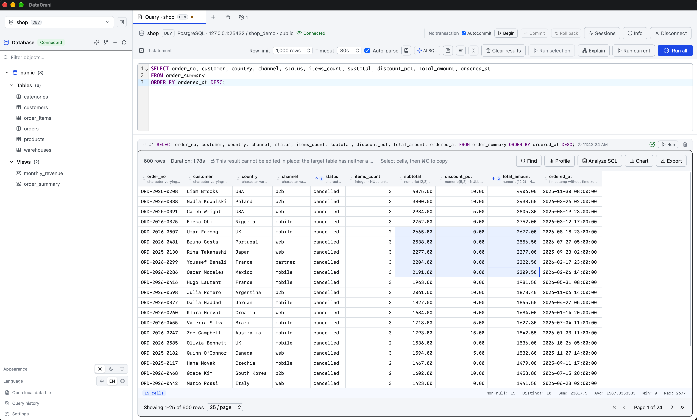
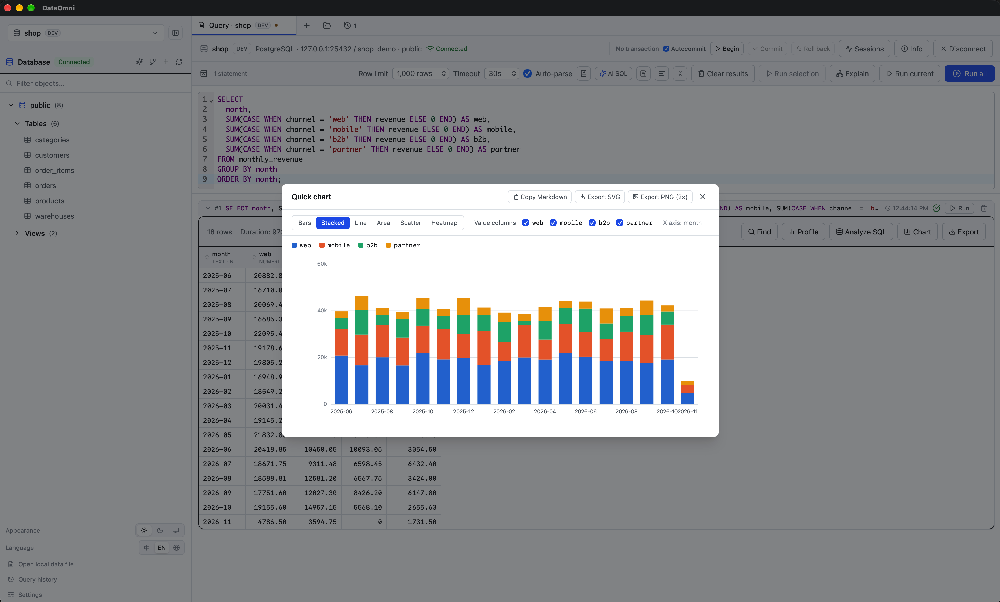
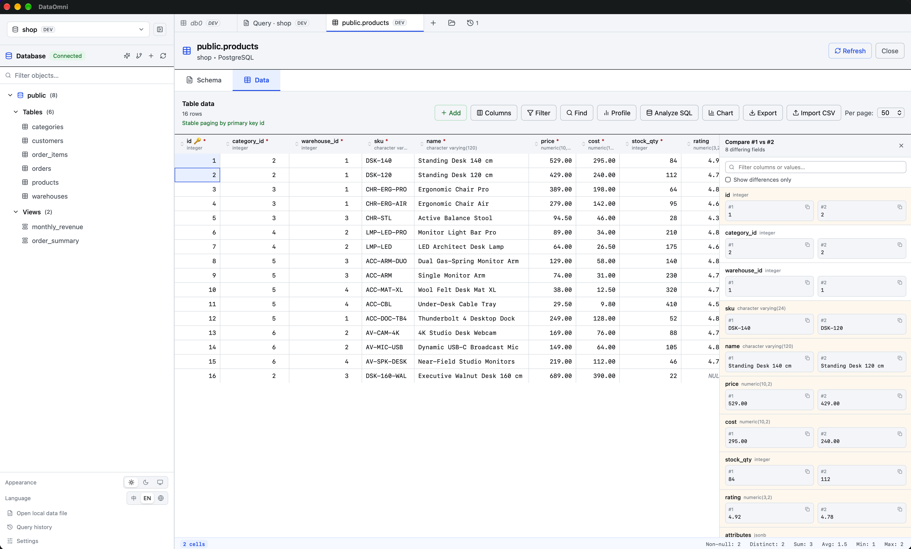
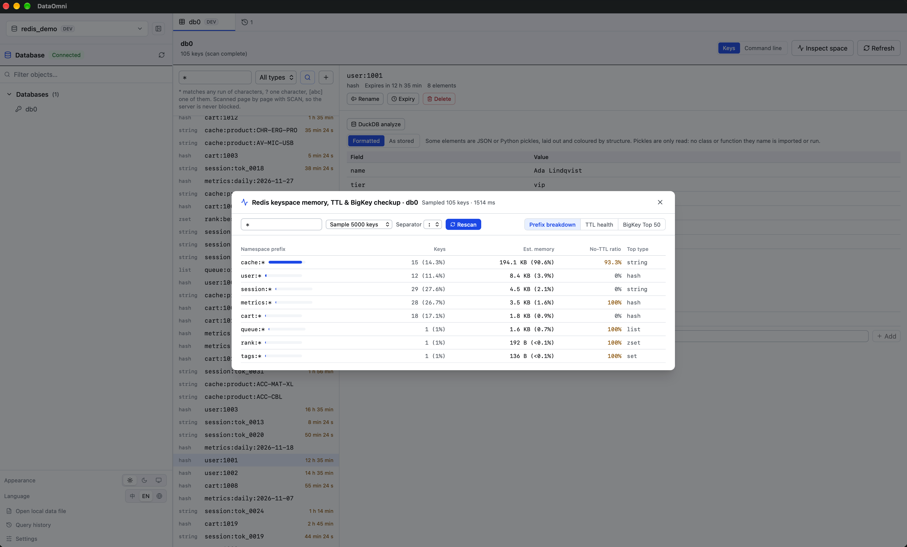

# DataOmni

**English** | [中文](README.md) | [Website](https://dataomni.dev)

A desktop database client for relational databases, MongoDB, Redis, Neo4j and Elasticsearch,
built with Tauri 2, React and Rust. It runs on macOS, Windows and Linux, and the interface is
available in English and Chinese (the language switch is at the bottom of the sidebar).



## Why DataOmni

- **One client for 14 kinds of servers.** MySQL, PostgreSQL, SQLite, SQL Server, Oracle, DuckDB and
  ClickHouse, plus MariaDB, TiDB, OceanBase, CockroachDB and openGauss through the compatible
  connection types. MongoDB, Redis, Neo4j and Elasticsearch each get their own workspace.
- **Every statement it sends is guarded.** Edits are queued, previewed as the exact SQL that will
  run, committed in one transaction, and each affected row count is checked. Destructive statements
  ask first, and the threshold depends on the connection's environment (production is stricter).
- **It shows what the database said.** Errors come with SQLSTATE, line and column, DETAIL, HINT,
  constraint and table names. A failed connection tells you which step broke: name resolution, a
  refused port, a port that accepts and drops the connection, or credentials.
- **Credentials stay in the system keychain** (macOS Keychain, Windows Credential Manager, Linux
  Secret Service). The configuration file only stores references.
- **Read-only access for AI agents.** The standalone `dataomni` CLI and `dataomni mcp` server let
  Claude Code, Claude Desktop, Cursor, Codex and similar agents query the non-production connections
  you explicitly opened, read-only, without launching the GUI or ever seeing a password.

## Compatibility

Every row below comes from smoke tests run against a real server (`src-tauri/tests/*_smoke.rs`),
not from protocol compatibility on paper. The last full run was on 2026-10-16. The
[Chinese README](README.md#兼容性矩阵) lists the known gaps of each server in detail.

| Server | Version | Connection type | Status |
| --- | --- | --- | --- |
| MySQL | 8.4 | MySQL | ✅ Supported |
| MySQL | 5.7.44 | MySQL | ⚠️ Usable, with gaps (TLS must be disabled; no `RENAME COLUMN`, renames restate the column) |
| PostgreSQL | 16 | PostgreSQL | ✅ Supported |
| SQLite | bundled | SQLite | ✅ Supported |
| MariaDB | 11.4 | MySQL | ✅ Supported |
| TiDB | 8.5 | MySQL | ✅ Supported |
| OceanBase | 4.4.2 CE, MySQL mode | MySQL | ⚠️ Usable, with gaps |
| CockroachDB | 25.2 | PostgreSQL | ⚠️ Usable, with gaps |
| openGauss | 5.0.3 | PostgreSQL | ⚠️ Usable, with gaps (sha256-password users supported) |
| SQL Server | 2022 | SQL Server | ✅ Supported |
| Oracle | 23ai Free | Oracle (Instant Client bundled) | ✅ Supported (service name or SID; TLS needs a wallet and is not supported, use an SSH tunnel) |
| DuckDB | 2.0.0, built in | DuckDB | ✅ Supported |
| ClickHouse | 25.8 | ClickHouse (HTTP) | ⚠️ Edits one row at a time, no transactions |
| MongoDB | 8.0 | MongoDB | ⚠️ Document-level, with gaps (no `db.coll.find()` JavaScript syntax) |
| Redis | 7.4 | Redis | ✅ Standalone, Sentinel and Cluster |
| Neo4j | 5.26 LTS, 2026.09 | Neo4j (Bolt) | ⚠️ Single instance; cluster routing only tested against a single instance |
| Elasticsearch | 8.19, 9.5 | HTTP | ⚠️ Single-node direct connection |
| OpenSearch | 3.8 | Elasticsearch | ⚠️ Single-node direct connection; no API key |

## Features

### Queries

- SQL editor with dialect-aware statement splitting (strings, comments and dollar-quoted bodies
  are handled), formatting, and completion from the live schema: tables, views and their columns,
  aliases (`FROM orders o` then `o.`), and keywords filtered by dialect.
- Timeouts and cancellation that stop the statement on the server, not just on the client.
- Results are capped by a row limit and streamed in batches. Several result sets per statement
  (`EXEC`, `CALL`) are shown one by one.
- Execution plans for each database, parsed into one expandable tree. PostgreSQL and SQL Server can
  run the statement for real and show actual rows and timings per step. The step whose estimate is
  off by an order of magnitude or more is pointed out.
- History records time, connection, statement, duration, status and affected rows, never result
  rows. Passwords in statements are replaced with `'***'` before they are written.
- Save a tab as a `.sql` file, open `.sql` files, and keep drafts across restarts.



### Browsing and editing data

- Server-side paging with stable ordering; sorting and filtering run in the database against the
  whole table.
- NULL, empty strings, whitespace-only values and binary values look different in the grid.
- Rows are located by a real primary key or a qualifying unique index. A query result is editable
  only when it can be proven to map to unique rows of one table; otherwise it is read-only and the
  reason is shown.
- Edits, inserts and deletes go into a pending queue. Preview the exact statements, undo items one
  by one, then commit them in one transaction. Original values are part of the `WHERE` clause, so a
  concurrent change makes the save fail instead of being silently overwritten.
- Structure editing (rename, type, nullability, default, add and drop columns, rename tables) and
  creating tables, indexes and schemas. Every change is previewed as SQL first, with what would be
  lost and which steps the dialect cannot do.
- Export results or whole tables to CSV, JSON or `INSERT` statements, streamed to disk with progress
  and cancellation. CSV import with a three-step wizard (delimiter and encoding detection, including
  GB18030), column mapping and failed rows reported by file line number.
- Backups through the native tools: `VACUUM INTO` for SQLite, `EXPORT DATABASE` for DuckDB, and the
  local `pg_dump`, `mysqldump` and `mongodump`.
- ER diagram of a whole database: search, filter by schema or by distance from a table, export to
  SVG, PNG or PDF, or to a data dictionary (Markdown) and an Agent Skill (`SKILL.md`).
- Code generation from the ER diagram (or an AI design): a Prisma schema, TypeORM or MikroORM entities
  (for NestJS), SeaORM entities, or sqlx `FromRow` structs. It is deterministic, without AI. Types it
  cannot map and tables it cannot generate are listed at the top.
- Schema compare: diff tables, columns, primary keys, indexes and foreign keys against another
  connection, tick what to sync, and get a script that makes the target match. The script opens in the
  editor and runs through the usual per-environment confirmation; across different kinds of database you
  get the report only.
- Bind parameters: write `:name` in the editor and fill in the values before the statement runs. The
  driver binds them, so nothing is pasted into the SQL and text needs no quotes. Not yet for ClickHouse
  or the execution plan.
- Query templates: save reusable SQL snippets (reusing `:name` bind parameters and an optional dialect
  filter) from the editor toolbar or command palette (`⌘K`), then insert them with Undo history preserved
  or insert and run immediately.
- Built-in sandboxed DuckDB analytics: profile columns (inferred type, null ratio, cardinality,
  quantiles, top-5 values) across SQL results, table views, MongoDB collections and Elasticsearch hits,
  run secondary SQL / `PIVOT` queries, export Apache Parquet, and explore local `.parquet` / `.csv` /
  `.tsv` / `.json` / `.ndjson` files ad-hoc without creating a connection (`enable_external_access = false`
  + `lock_configuration = true`, capped at 100k rows / 512 MB).
- Native SVG charts: bar, stacked-bar, line, area, scatter and 24×24 heatmap charts with SVG and 2× PNG
  export. Never adds a dual Y-axis; beyond 200 rows, offers explicit in-memory DuckDB aggregation
  (`SUM`/`AVG`/`COUNT`/`MAX`/`MIN` + Top N) instead of silent sampling.




### MongoDB, Redis, Neo4j and Elasticsearch

- **MongoDB**: databases, collections and views; filter, sort and edit documents in mongosh syntax;
  bulk update and delete by filter; aggregation pipelines; indexes and validation rules; import and
  export in mongoexport format; a `db.runCommand` console. SRV (Atlas), TLS, client certificates and
  X.509 authentication are supported.
- **Redis**: databases with keys, `SCAN`-based key browsing by pattern and type, viewers and editors
  for string, hash, list, set, sorted set and stream values. Python pickle and JSON values are decoded
  and highlighted. A console with redis-cli syntax and output. Sentinel and Cluster are supported.
- **Neo4j**: labels and relationship types, a Cypher editor, results drawn as a graph, and editing
  nodes and relationships (properties, labels, creating and deleting). `EXPLAIN` and `PROFILE` plans.
- **Elasticsearch / OpenSearch**: indices, aliases and data streams, a console in Kibana Dev Tools
  syntax, tables for hits, ES|QL / SQL results and aggregations, a mapping viewer, and editing or
  deleting single documents with optimistic concurrency.




### Connections and security

- TLS modes from "disable" to "verify hostname", with CA and client certificates.
- SSH tunnels with keys (passphrase-protected keys too) or passwords. Host keys are checked against
  `~/.ssh/known_hosts`; there is no "skip verification" switch.
- Each connection is marked as development, testing, staging or production and shows a text badge
  (DEV, TEST, STAGING, PROD), not only a color.
- Export connections to a JSON file (without passwords or SSH keys), and preview-import connections
  from DataOmni JSON, Navicat `.ncx` or DBeaver `data-sources.json` (with encrypted secrets stripped
  and command-line / agent access reset to off).

### AI (optional, off by default)

- **Zero table rows ever leave the machine**, every outgoing prompt is inspectable before/during
  sending, and DataOmni never executes AI-generated SQL automatically.
- **Table design**: describe what you need in one line → validated multi-table design, ER diagram,
  editable foreign-key `ON DELETE` rules, and previewed `CREATE TABLE` SQL generated deterministically
  by DataOmni.
- **SQL editor assist**: natural-language SQL generation and selection rewrite (incorporating local
  connection business semantics), one-click error diagnosis and fix, and EXPLAIN plan bottleneck /
  candidate index interpretation.
- **ER semantics drafting**: batch-draft table and column business descriptions in the ER view, edit
  and save them into local `semantics/<id>.md` to enrich human-readable data dictionaries, editor AI,
  and external CLI / MCP agents.
- Two interface types cover most providers: Anthropic and OpenAI-compatible (DeepSeek, Qwen, Zhipu,
  Kimi, local Ollama, and others), with multiple presets, connection testing, mid-flight cancellation,
  keyless local endpoints (auto-bypassing system proxy), and a "local models only for `STAGING`/`PROD`"
  guardrail. API keys stay in the system keychain.
- Builds without AI: `bun tauri build -- --no-default-features` leaves the code that talks to model
  services out of the binary.

### Command line and agents

The standalone `dataomni` CLI (with backward-compatible alias `dataomni cli <command>`) gives
terminals and AI agents read-only access to the connections you configured in the app, headless,
without ever handing over a password.

- Access is opt-in per connection (connection form → "Command line & agent access": off or
  read-only; off by default). Production connections are never visible, and no command-line flag changes that.
- Relational databases: `query` (with `:name` bind parameters via `--param` / `--param-null` /
  `--params-json`), `explain` (never `ANALYZE`), `schema`, `ddl`, `diff` (read-only cross-connection
  schema diff in JSON or Markdown), `dictionary` (automatically enriched with local business semantics
  from `semantics/<id>.md`), `profile` (built-in DuckDB column profiling, plus `--file` on CLI),
  `export` (CSV / JSON / Parquet), `backup` and `test`. Only a single read statement is accepted, and
  it runs inside the database's own read-only transaction, ending in a rollback.
- MongoDB, Redis, Neo4j and Elasticsearch each have read-only commands. For example, Redis only runs
  commands the server itself flags as `readonly`.
- Interactive terminals get pretty-printed, syntax-highlighted JSON and Markdown automatically, while
  piped output stays compact plain JSON (`--pretty`, `--compact`/`-c`, `--color`, `--no-color`,
  `NO_COLOR`). Exit codes distinguish database errors, bad arguments, refusals and connection failures.
  `dataomni guide` (identical to the hosted [`https://dataomni.dev/SKILL.md`](https://dataomni.dev/SKILL.md))
  prints an agent skill ready to save as `SKILL.md`.
- Settings → Command line & Agent provides one-click Claude Code / Claude Desktop / Cursor setup
  snippets, `SKILL.md` export, and a read-only viewer for the `dataomni-cli.log` audit trail (which
  records leading keyword, length and SHA-256 only—never raw SQL or bind values).
- Agents that cannot run a shell (Claude Desktop and the like) can use `dataomni mcp`, the same
  read-only commands served as an MCP server over stdio with persistent SSH tunnel reuse, behind the
  same access rules. Local file tools (`export`, `backup`, `csv-preview`, `profile --file`) are
  excluded from MCP. Example:
  `claude mcp add dataomni -- /Applications/DataOmni.app/Contents/MacOS/dataomni mcp`.

The real boundary is still a read-only database account: the app blocks writes, but not
administrative functions such as `pg_terminate_backend`.

## Install

Download a package from [Releases](https://github.com/dataomni-rs/DataOmni/releases):

| Platform | Package |
| --- | --- |
| macOS 12+ (Apple Silicon) | `brew install --cask dataomni-rs/tap/dataomni` or `DataOmni_<version>_aarch64.dmg` |
| Windows (x64) | `DataOmni_<version>_x64-setup.exe` or `DataOmni_<version>_x64_en-US.msi` |
| Linux (x64, glibc 2.34+) | `DataOmni_<version>_amd64.deb` or `DataOmni-<version>-1.x86_64.rpm` |

First-launch and platform notes:

- **macOS**: official releases (`v1.2.1`+) are signed with an Apple Developer ID and notarized by Apple, so
  `DataOmni.app` opens directly without Gatekeeper quarantine workarounds. Installing via Homebrew Cask
  (`brew install --cask dataomni-rs/tap/dataomni`) also links the `dataomni` CLI into `$(brew --prefix)/bin/dataomni`.
  If upgrading once from an earlier ad-hoc signed build (`<= 1.2.0`), macOS Keychain will ask once per saved secret
  to authorize the Developer ID team; future signed updates reuse that authorization.
- **Windows**: there is no Windows code-signing certificate yet; when SmartScreen says "Windows protected your PC",
  click "More info" → "Run anyway".
- **Linux**: `sudo apt install ./DataOmni_*.deb` or `sudo dnf install ./DataOmni-*.rpm`. Saving
  passwords needs an unlocked Secret Service (gnome-keyring on GNOME).

The Oracle Instant Client (Basic Light) is bundled, so Oracle works without installing anything.
macOS on Intel is not built yet. On Windows on ARM, the x64 package runs under emulation.

The app checks for new versions at most once a day and never downloads or installs updates silently:
standalone macOS (`.dmg`) and Windows (`.msi` / `-setup.exe`) installs (`v1.2.2`+) offer user-confirmed
Ed25519-signed in-app upgrades, while Homebrew Cask installs provide a one-click
`brew upgrade --cask dataomni` copy button.

## Build from source

Requirements: Rust, [Bun](https://bun.sh), and on Linux the Tauri system dependencies:

```bash
sudo apt-get install build-essential curl wget file pkg-config libssl-dev \
  libwebkit2gtk-4.1-dev libxdo-dev libayatana-appindicator3-dev librsvg2-dev xdg-utils
```

```bash
git clone https://github.com/dataomni-rs/DataOmni.git
cd DataOmni
bun install

bun tauri dev      # development
bun tauri build    # release build
bun run check      # lint, typecheck, frontend tests, cargo fmt / clippy / tests
```

## Documentation

- **English Guides ([dataomni.dev](https://dataomni.dev))**:
  [Quickstart](https://dataomni.dev/docs/quickstart/),
  [Read-Only MCP Server](https://dataomni.dev/docs/mcp/),
  [Agent CLI](https://dataomni.dev/docs/cli/),
  [Database Guides](https://dataomni.dev/docs/databases/),
  [Changelog](https://dataomni.dev/changelog/), and
  [Privacy & Security](https://dataomni.dev/privacy/).
- **Design & Chinese Manual**: [User manual](docs/user-manual.md) and
  [CLI / MCP design RFCs](rfcs/mcp-server.md) (Chinese).

## Contributing

Issues and pull requests are welcome: [Issues](https://github.com/dataomni-rs/DataOmni/issues).
Run `bun run check` before opening a pull request.

## License

[MIT](LICENSE)
